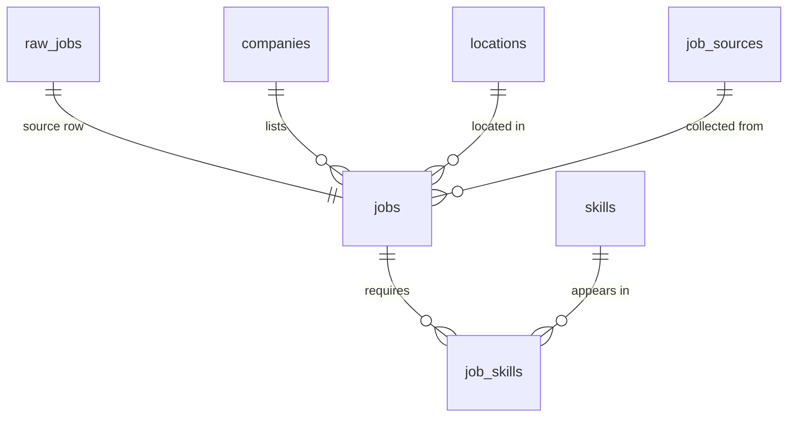

# Syrian Tech Job Postings Analysis

An exploratory PostgreSQL project on technology job postings collected for a study of opportunities relevant to Syrian job seekers. It models companies, locations, postings, and skills; uses SQL to clean and check the data; and examines skill demand, junior requirements, and salary disclosure.

**Scope:** 203 postings dated **2024-09-02 to 2026-04-09**, from 70 company names after explicit name normalization. The sample includes 127 postings labeled `Local_Syria`, 5 labeled `Gulf_Remote`, and 71 labeled `Other`. It is not a census of jobs located in Syria.

## Key findings from the supplied CSV

Each skill count is the number of **distinct source postings** mentioning the skill. See [the source profile](data/source_profile.json) and the script that regenerates it.

| Measure | Count |
| --- | ---: |
| Postings | 203 |
| Canonical company names | 70 |
| REST API | 69 |
| Git | 66 |
| CI/CD | 52 |
| Python | 49 |
| Junior postings | 46 |
| Postings disclosing a simple numeric salary/range | 10 |

## Model and workflow



- `raw_jobs.raw_job_id` is generated at import; `jobs.raw_job_id` preserves one-to-one lineage.
- `job_skills` represents the many-to-many relationship between postings and skills.
- The transform trims fields, maps a small list of known company/skill aliases, parses simple salary ranges, and keeps unknown values missing.
- `origin_type` belongs to each posting because a single company name can appear with multiple origin labels.
- Quality checks surface possible duplicate ads, missing fields, and salary strings the parser did not recognize. A possible duplicate is not automatically removed.

## Repository files

| File | Use |
| --- | --- |
| `sql/01_schema.sql` | Staging and normalized tables |
| `sql/02_transform.sql` | Load modeled tables from `raw_jobs` |
| `sql/03_quality_checks.sql` | Data profiling and anomaly checks |
| `sql/04_analysis.sql` | Core analytical queries |
| `scripts/validate_source.py` | Independent CSV profiling with the Python standard library |
| `data/jobs_raw.csv` | Supplied source postings |
| `data/source_profile.json` | Results from the supplied source CSV |
| `powerbi/analytics.pbix` | Original Power BI dashboard |
| `archive/base_original.sql` | Original exploratory SQL |
| `docs/previous_posts/` | PDFs previously shared on LinkedIn |
| `docs/REPORT_RECONCILIATION.md` | Detailed comparison of old and revised counts |

The PBIX and earlier PDF posts are included as the original presentation of the work. The SQL scripts and source profile provide the revised source-row-based counts.

## Reproduce with your own authorized CSV

Requirements: PostgreSQL, `psql`, Python 3. The example assumes an empty database and uses the included `data/jobs_raw.csv`.

```bash
createdb syrian_jobs
psql -X -v ON_ERROR_STOP=1 -d syrian_jobs -f sql/01_schema.sql
python3 scripts/validate_source.py data/jobs_raw.csv
```

Import using `psql` (the source file uses the literal `NULL` for missing values):

```sql
\copy raw_jobs (job_title,company_name,origin_type,city,country,source,experience_level,experience_years_min,experience_years_max,job_type,posted_date,salary,skills,description) FROM 'data/jobs_raw.csv' WITH (FORMAT csv, HEADER true, ENCODING 'UTF8', NULL 'NULL');
```

Then run:

```bash
psql -X -v ON_ERROR_STOP=1 -d syrian_jobs -f sql/02_transform.sql
psql -X -v ON_ERROR_STOP=1 -d syrian_jobs -f sql/03_quality_checks.sql
psql -X -v ON_ERROR_STOP=1 -d syrian_jobs -f sql/04_analysis.sql
```

The source file has the 14 columns listed in [the data dictionary](data/README.md). The transform can be rerun after edits to `raw_jobs`; importing the same CSV twice will create duplicate source rows. SQL scripts were reviewed and the CSV profile was run, but PostgreSQL execution was unavailable in the preparation environment. Check the database results against `source_profile.json` before refreshing the included PBIX.

## Limitations

- Collection channels include Telegram, SYNC, LinkedIn, and Facebook. The sample has unknown coverage and may overrepresent particular channels, employers, or dates.
- Dates reflect the supplied `posted_date` field. The dataset has candidate duplicates based on title, company, and date; no automatic deduplication was assumed.
- Salary units and currency were not recorded in a dedicated field. Only ten rows have parseable numeric salaries; this is too little for broad salary conclusions.
- Skill aliases and role labels require further manual review. A skill in an ad is a stated requirement, not evidence of actual workplace use.

## Author

[Suleiman Al-Ali](https://www.linkedin.com/in/suleiman-al-ali-a27ba529a/) · [GitHub](https://github.com/SuLeImaNSAA)

## Note on the earlier dashboard and posts

The original Power BI file and LinkedIn PDFs show REST API in **109** postings. In the original SQL, `jobs.title = raw_jobs.job_title` linked advertisements that shared a title: for example, a Full Stack Developer posting without REST API could inherit that skill from another Full Stack Developer posting. Of the 109, **69 source postings actually mention REST API** and 40 were matched through the shared title. The revised SQL joins each posting by its unique `raw_job_id`; the included PBIX is the original, unrefreshed report.
